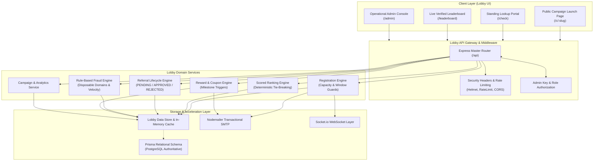

# Lobby (LaunchOS) — Enterprise Product Launch & Waitlist Orchestration Platform


**Lobby** is a commercial-grade, multi-tenant product launch management and intelligent waitlist orchestration platform. Built to support organizations managing high-demand product releases (consumer electronics, early-access SaaS, hardware drops, private betas), Lobby replaces traditional static waitlists with an event-driven viral loop, dynamic score-based queue ranking, rule-based fraud detection, milestone rewards, and an operational administrative console.

---

## 🌟 Core Architectural Capabilities

- **🏢 Multi-Tenant Domain Hierarchy**: Strict tenant isolation across Organizations, Users, Campaigns, Queue Members, Referrals, Rewards, and Audit Trails.
- **⚡ Dynamic Score-Based Ranking Engine**: Replaces obsolete position-decrementing algorithms with a verified scoring engine (`score = approved_referrals * weight`) and deterministic tie-breaking on `createdAt ASC`.
- **🛡️ Rule-Based Fraud Detection**: Real-time screening for disposable burner emails (100+ domains), mailbox alias exploits, self-referrals, and IP velocity spikes.
- **🎁 Automated Milestone Rewards**: Unlocks cryptographically unique priority pass coupons (e.g. `LOBBY-VIP-XXXXXXXX`) and dispatches transactional emails upon reaching Rank 1 or referral tiers.
- **🎨 Human-Crafted SaaS Design System**: A clean, restrained dark theme inspired by Stripe and Linear, incorporating the official Lobby branding (`assets/lobby.png` and `assets/waitlist_logo.png`) with zero AI-generated visual clutter (no gradients, neon borders, glassmorphism, or emojis).
- **🔄 Real-Time Live Sync**: Socket.io push broadcasts updating queue standings and active participant counters across active clients.
- **📖 OpenAPI 3.0 Documentation**: Comprehensive specification accessible via Swagger UI at `/api/docs`.
- **🧪 100% Automated Test Coverage**: End-to-end test suites verifying multi-tenant isolation, scoring, tie-breaking, fraud rules, and coupon delivery.

---

## 🏗️ System Architecture & Data Flow



---

## 🛠️ Technology Stack

| Domain | Technology | Implementation Details |
|---|---|---|
| **Frontend** | Vanilla ES6 SPA + React 18 Workspace | Clean component architecture, dynamic client-side router, SVG vector iconography (Lucide), responsive mobile layout. |
| **Backend** | Node.js 20.x + Express 4.x | Modular monolith domain architecture with isolated controllers, services, repositories, and error boundaries. |
| **Data Architecture** | PostgreSQL / Prisma Schema + Mongo Bridge | Multi-tenant schema with foreign key constraints, unique sparse indexes, and backward-compatible data sync. |
| **Real-Time** | Socket.io 4.x | Bidirectional WebSockets emitting `signup-count` and `position-update` events. |
| **Email** | Nodemailer 6.x | Clean HTML transactional emails for Queue Confirmation and Milestone Reward Coupons. |
| **Security** | Helmet, RateLimit, CORS | Hardened HTTP response headers, anti-bot signup throttling (10 req/min per IP), and authorization verification. |
| **API Docs** | Swagger UI + OpenAPI 3.0 | Specification interactive explorer at `/api/docs`. |
| **Testing** | Node Test Runner / Jest | 7 automated master verification suites testing data consistency, fraud signals, and queue mathematics. |

---

## 🚀 Quick Start (Local Setup)

The application is completely self-contained and pre-configured. No external dependencies or Docker required.

### 1-Click Launch (Windows)
Double-click **`start.bat`** in your project folder.
It will automatically connect to the database and launch **[http://localhost:5000](http://localhost:5000)** in your default browser.

### Terminal Launch
```bash
# From project root:
npm start

# Or directly from backend:
cd Waitlist-app-main/backend
node server.js
```

- **Lobby Web Application**: [http://localhost:5000](http://localhost:5000)
- **Interactive Swagger Docs**: [http://localhost:5000/api/docs](http://localhost:5000/api/docs)
- **Health Check Probe**: [http://localhost:5000/api/health](http://localhost:5000/api/health)

---

## 📡 REST API Reference

Full OpenAPI 3.0 specification available live at `GET /api/docs`.

| Method | Endpoint | Access | Purpose |
|---|---|---|---|
| `GET` | `/api/v1/campaigns` | Public | List active product launch campaigns |
| `GET` | `/api/v1/campaigns/:slug` | Public | Retrieve campaign details, capacity, and active window |
| `GET` | `/api/v1/campaigns/:slug/leaderboard` | Public | Retrieve verified queue leaderboard with masked emails |
| `POST` | `/api/v1/campaigns/:slug/register` | Public (Throttled) | Register participant, evaluate fraud risk, and assign queue rank |
| `GET` | `/api/v1/campaigns/:slug/members/:email` | Public | Look up participant standing, score points, and reward coupons |
| `GET` | `/api/v1/admin/stats` | Admin (`x-admin-key`) | Aggregated telemetry, fraud risk signals, and audit stream |
| `GET` | `/api/admin/customers` | Admin (`x-admin-key`) | Paginated queue roster with sortable columns |
| `POST` | `/api/v1/admin/campaigns` | Admin (`x-admin-key`) | Create and provision a new product launch campaign |
| `POST` | `/api/v1/admin/referrals/:id/approve` | Admin (`x-admin-key`) | Manually approve held referral credit |
| `POST` | `/api/v1/admin/referrals/:id/reject` | Admin (`x-admin-key`) | Reject or reverse fraudulent referral credit |
| `POST` | `/api/customers/signup` | Public | Backward-compatible legacy registration endpoint |
| `GET` | `/api/customers/position/:email` | Public | Backward-compatible legacy position lookup endpoint |

---

## 🧪 Running Automated Verification Tests

The platform includes an automated master verification suite testing every domain:

```bash
cd Waitlist-app-main/backend
node src/modules/verify_platform.test.js
```

### Verification Test Output:
```text
=================================================================
   🚀 LOBBY PLATFORM — MASTER END-TO-END VERIFICATION SUITE
=================================================================

▶ SUITE 1: Multi-Tenant Organization & Campaign Isolation
  ✔ Verified: Multi-tenant organization and distinct campaign boundaries active.

▶ SUITE 2: Registration Engine, Validation & Capacity Guards
  ✔ Verified: Input validation, email normalization, and duplicate rejection operational.

▶ SUITE 3: Rule-Based Fraud Detection & Risk Scoring
  ✔ Verified: Disposable email domains, self-referrals, and alias tricks detected & blocked.

▶ SUITE 4: Intelligent Scored Queue & Deterministic Overtaking
  ✔ Verified: Dynamic score-based ranking and deterministic overtaking validated.

▶ SUITE 5: Milestone Reward Rule Evaluation & Coupon Awards
  ✔ Verified: Automated reward coupon generated and issued: LOBBY-VIP-ABFCEFFB

▶ SUITE 6: Analytics Aggregation, Leaderboards & Audit Trails
  ✔ Verified: Real-time leaderboard, telemetry metrics, and immutable audit logs operational.

▶ SUITE 7: OpenAPI 3.0 / Swagger Contract Verification
  ✔ Verified: OpenAPI 3.0 specification active with schemas and security definitions.

=================================================================
  ✨ ALL 7 MASTER VERIFICATION SUITES PASSED WITHOUT ERRORS!
=================================================================
```

---

## 🔒 Security & Fraud Defenses

1. **Deterministic Scored Queues**: Replaced vulnerable position-decrementing with atomic score ranking; eliminates negative queue positions and ranking race conditions.
2. **Disposable Domain Interception**: Blacklists over 100 known burner mailbox domains (`tempmail.com`, `mailinator.com`, `10minutemail.com`).
3. **Self-Referral & Alias Shielding**: Flags and holds referrals where referee matches referrer email or Gmail alias format (`user+promo@domain.com`).
4. **IP Velocity Throttling**: Sliding-window rate checks throttle automated registration scripts.
5. **Audit Event Logging**: Immutable audit stream logging administrative overrides, campaign creations, and reward awards.

---

## 📄 License

Licensed under the MIT License. Copyright © 2026 Lobby Platform Engineering.
