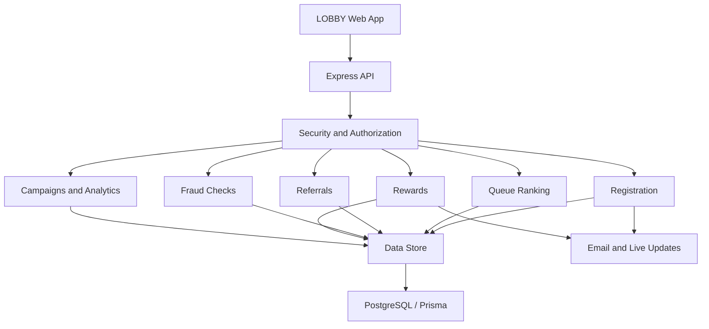

# LOBBY

A product launch and waitlist management platform for teams running product releases, early-access programmes, and private launches.

LOBBY helps teams manage registrations, referrals, queue positions, rewards, and campaign activity from one place.

## Features

- **Campaign management:** Create and manage product launch campaigns.
- **Waitlist ranking:** Rank participants using approved referrals, with a consistent tie-break rule.
- **Referral tracking:** Track referrals through pending, approved, and rejected states.
- **Fraud checks:** Flag disposable email addresses, self-referrals, email aliases, and unusual signup activity.
- **Milestone rewards:** Issue unique reward coupons when participants reach configured milestones.
- **Live updates:** Broadcast queue and signup changes using Socket.IO.
- **Admin tools:** View campaign activity, queue members, analytics, and audit events.
- **API documentation:** Explore the API through Swagger UI at `/api/docs`.

## Tech Stack

| Area | Technology |
|---|---|
| Frontend | Vanilla JavaScript (ES6), with a React 18 workspace |
| Backend | Node.js 20, Express 4 |
| Database | PostgreSQL, Prisma, and a MongoDB bridge |
| Real-time updates | Socket.IO |
| Email | Nodemailer |
| Security | Helmet, rate limiting, and CORS |
| API documentation | Swagger UI, OpenAPI 3.0 |
| Testing | Node.js test runner and Jest |

## Architecture

The application is organised as a modular backend. The API routes requests to services responsible for registration, queue ranking, referrals, fraud checks, rewards, and campaign analytics.

PostgreSQL is the primary relational data store. Socket.IO handles live updates, and Nodemailer sends transactional emails.



## Getting Started

### Requirements

- Node.js 20 or later
- npm
- Access to the configured database

### Run on Windows

Double-click `start.bat` from the project folder.

The application should start at:

`http://localhost:5000`

### Run from the terminal

From the project root:

```bash
npm install
npm start
```

Or start the backend directly:

```bash
cd Waitlist-app-main/backend
npm install
node server.js
```

### Local URLs

| Service | URL |
|---|---|
| Web application | `http://localhost:5000` |
| API documentation | `http://localhost:5000/api/docs` |
| Health check | `http://localhost:5000/api/health` |

Make sure the database and required environment variables are configured before starting the application.

## API Overview

The full API specification is available at `GET /api/docs`.

| Method | Endpoint | Access | Description |
|---|---|---|---|
| `GET` | `/api/v1/campaigns` | Public | List active campaigns |
| `GET` | `/api/v1/campaigns/:slug` | Public | Get campaign details |
| `GET` | `/api/v1/campaigns/:slug/leaderboard` | Public | View the verified leaderboard |
| `POST` | `/api/v1/campaigns/:slug/register` | Public | Register for a campaign |
| `GET` | `/api/v1/campaigns/:slug/members/:email` | Public | Check a participant's queue status |
| `GET` | `/api/v1/admin/stats` | Admin | View campaign and platform statistics |
| `GET` | `/api/admin/customers` | Admin | View the participant list |
| `POST` | `/api/v1/admin/campaigns` | Admin | Create a campaign |
| `POST` | `/api/v1/admin/referrals/:id/approve` | Admin | Approve a referral |
| `POST` | `/api/v1/admin/referrals/:id/reject` | Admin | Reject a referral |
| `POST` | `/api/customers/signup` | Public | Legacy signup endpoint |
| `GET` | `/api/customers/position/:email` | Public | Legacy queue position lookup |

Admin endpoints use the `x-admin-key` header.

## Run Tests

Run the platform verification suite from the backend directory:

```bash
cd Waitlist-app-main/backend
node src/modules/verify_platform.test.js
```

The suite checks:

1. Organisation and campaign isolation
2. Registration validation and capacity limits
3. Fraud detection rules
4. Queue scoring and ranking
5. Reward conditions and coupon generation
6. Analytics, leaderboards, and audit events
7. OpenAPI documentation

## Security

LOBBY includes several checks to help protect campaign registrations and queue integrity:

- Rate limiting on registration requests
- Checks for disposable email domains
- Detection of self-referrals and common email alias patterns
- Referral review before credit is applied
- Audit logging for administrative actions and reward events
- Consistent queue ranking to avoid position conflicts

## License

This project is licensed under the MIT License.
