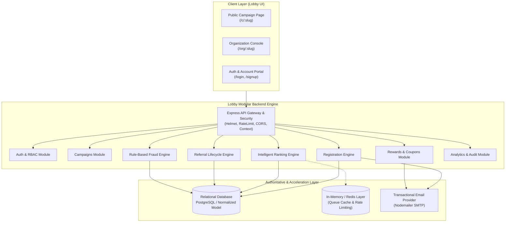

# PROJECT AUDIT: WAITLIST APP TO LOBBY / LAUNCHOS PLATFORM

**Date:** 2026-11-15  
**Auditor:** Principal Software Architect & Engineering Team  
**Scope:** Existing codebase audit, architectural discrepancy analysis, migration risks, and transition plan to the Lobby (LaunchOS) commercial SaaS platform.

---

## 1. Executive Summary

The current repository contains a single-tenant prototype built as a demonstration waitlist for an Apple iPhone product launch. While recent enhancements added essential bug fixes (fixing initial inverted queue ranking, adding server-side Nodemailer, sparse unique indexes, basic rate limiting, and an admin statistics route), the existing system is **fundamentally a single-campaign prototype**, not an enterprise multi-tenant SaaS platform.

To achieve the vision laid out in the Master Engineering Prompt for **Lobby** (multi-tenant product launch orchestration, intelligent score-based queue engine, referral qualification lifecycle, rule-based fraud detection, campaign management, and a clean human-designed UI system), the project requires a disciplined, phase-driven architectural transition.

---

## 2. Directory Structure & File Audit

```text
Waitlist-app-main/
├── Waitlist-app-main/
│   ├── backend/
│   │   ├── config/
│   │   │   └── swagger.js             [OpenAPI 3.0 specs; depends on uninstalled swagger-jsdoc]
│   │   ├── models/
│   │   │   └── Customer.js            [Single flat Mongoose schema: name, email, referralCode, position, referralCount]
│   │   ├── routes/
│   │   │   ├── admin.js               [Admin stats and paginated list protected by static header key]
│   │   │   └── customers.js           [POST /signup and GET /position/:email]
│   │   ├── services/
│   │   │   └── emailService.js        [Nodemailer wrapper with HTML templates and graceful fallback]
│   │   ├── public/
│   │   │   ├── index.html             [Interactive single-page application served directly by Express]
│   │   │   └── assets/                [bg.png, logo.png]
│   │   ├── __tests__/                 [signup, position, admin, customer model mock test suites]
│   │   ├── server.js                  [Express HTTP server with defensive fallback middleware]
│   │   ├── package.json               [Dependencies mix: contains unused/uninstalled modules]
│   │   └── .env                       [MongoDB URI with URL-encoded credentials, port, admin key]
│   ├── frontend/
│   │   ├── src/
│   │   │   ├── components/            [SignupForm.js, PositionDisplay.js]
│   │   │   ├── pages/                 [CheckPosition.js, AdminDashboard.js]
│   │   │   ├── services/api.js        [Fetch wrapper for backend API]
│   │   │   └── App.js                 [React Router v6 implementation]
│   │   ├── package.json               [React 18 CRA setup; uninstalled dependencies in node_modules]
│   │   └── nginx.conf / Dockerfile    [Container configs for Nginx reverse proxy]
│   ├── lobby.png                      [Target brand lockup: "L" logo + "Lobby" wordmark]
│   ├── waitlist_logo.png              [Target brand icon: Warm amber/brown archway with waiting bench]
│   ├── prompt.txt                     [Master Engineering Specification]
│   ├── README.md                      [Documentation detailing feature set and architecture]
│   ├── docker-compose.yml             [Docker orchestration for Node, Mongo, and Nginx]
│   └── start.bat                      [Windows launcher]
```

---

## 3. Comprehensive Technical Assessment

### 3.1 What Currently Works
- **Basic Registration & Referral Attribution:** Users can register with name and email, receive a unique referral link (`uuidv4()`), and provide a referral code during signup.
- **Queue Position Allocation:** New customers are assigned `maxPosition + 1`. Referrers are decremented by 1 (`Math.max(1, position - 1)`).
- **Position Lookup:** `GET /api/customers/position/:email` returns the user's standing and referral count.
- **Server-Side Email Dispatch:** Asynchronous welcome emails and coupon emails (`COUPON-XXXXXXXX`) triggered via Nodemailer with non-blocking `.catch()` handlers.
- **Defensive Express Middleware:** `backend/server.js` starts immediately on port 5000 with fallbacks for missing optional packages (Helmet, Morgan, Rate Limit).
- **Static Frontend SPA:** `backend/public/index.html` provides a functional UI with Join, Check Position, and Admin views, copy-to-clipboard, and canvas confetti.

### 3.2 What Partially Works
- **Admin Security:** `routes/admin.js` validates `req.headers["x-admin-key"] === process.env.ADMIN_KEY`. Works for a single developer, but lacks session tokens, JWTs, user roles, or multi-tenant authorization.
- **Socket.io Real-Time Updates:** Backend sets up `io` and emits `position-update` and `signup-count`, but the client-side fallback does not maintain a persistent WebSocket connection if `socket.io-client` isn't bundled.
- **Automated Tests:** Comprehensive Jest tests are authored in `backend/__tests__/`, but Jest is not installed in the local `node_modules` directory, preventing local execution without a global package manager.
- **Frontend React Workspace:** The React app in `frontend/src` is well-structured, but requires `npm install` and build tooling to run independently of the Express static server.

### 3.3 What is Broken or Inconsistent
- **Queue Calculation Vulnerability (Direct Decrementing):** The current system directly mutates `referrer.position = position - 1`. If User B signs up and moves User A from #10 to #9, and someone else was already #9, two users can share the same rank, or positions become disjointed. As specified in Section 11 of the prompt, position decrementing is obsolete; a true score-based queue engine with deterministic tie-breaking is required.
- **Double Folder Nesting:** The workspace has `Waitlist-app-main/Waitlist-app-main`, causing path resolution quirks if executed from the root.
- **Unverified Documentation:** The existing README and docs describe Docker, PostgreSQL, and full React toolchains as operational, whereas local execution currently relies on Node + Express fallback.

### 3.4 What is Insecure
- **Single Static Admin Key:** A single shared password in `.env` (`ADMIN_KEY`) controls all admin capabilities without user audit logs.
- **No Role-Based Access Control (RBAC):** No distinction between Platform Super Admin, Organization Owner, Campaign Manager, or Customer.
- **Email Enumeration / Scraping:** `GET /position/:email` returns whether an email exists in the database.
- **No Fraud Mitigation:** Self-referrals and automated bot registrations are only guarded by IP rate limiting; disposable domains, velocity spikes, and device reuse are unmonitored.

### 3.5 What is Inefficient
- **O(N) Database Sort on Registration:** `Customer.findOne().sort({ position: -1 })` runs on every signup to find the latest queue number. Under high concurrency, this locks or slows down.
- **No Redis Acceleration:** Queue rankings and leaderboard aggregations query MongoDB repeatedly rather than using fast sorted sets (ZREVRANGEBYSCORE).
- **Synchronous MongoDB Operations in Route Handlers:** Heavy aggregation for admin stats runs directly within the request-response cycle without caching.

### 3.6 What Should Be Retained
- **Core Product Mechanics:** Viral referral loop, milestone rewards (coupons at #1), and non-blocking transactional email delivery.
- **Defensive Error Handling:** The pattern of zero-crash fallbacks ensuring the server remains alive and responsive under environment constraints.
- **Brand Assets:** The official `lobby.png` wordmark and `waitlist_logo.png` icon mark provided by the product team.

### 3.7 What Should Be Refactored
- **Queue Calculation Algorithm:** Replace direct position manipulation with score-based ranking (`score = approved_referrals * weight + bonuses`) with tie-breaking on `created_at ASC`.
- **Database Schema:** Transition from a single flat `Customer` table to a normalized multi-tenant relational schema (Organizations, Campaigns, Users, CampaignMembers, Referrals, Rewards, FraudSignals).
- **Backend Architecture:** Reorganize into a modular monolith with domain separation (controllers, services, repositories, validators).

### 3.8 What Should Be Replaced
- **The iPhone-Specific Branding:** Replace the single-product iPhone theme with the **Lobby** multi-tenant design system capable of hosting any campaign (electronics, early-access SaaS, events, private betas).
- **Flat Header Auth:** Replace `x-admin-key` with secure session/JWT authentication and RBAC.

### 3.9 What is Missing (Per Master Prompt Requirements)
1. **Multi-Tenancy:** Organization entity, tenant isolation, and organization membership.
2. **Campaign Management:** Ability to create, configure, open, close, and monitor multiple independent campaigns.
3. **Intelligent Queue & Scoring Engine:** Configurable scoring signals, rank recalculation, and tie-breaking.
4. **Referral Qualification Lifecycle:** Referrals tracked through statuses: `PENDING` -> `APPROVED` -> `REJECTED` -> `REVERSED`.
5. **Rule-Based Fraud Detection:** Disposable email checks, velocity checks, device/IP reuse detection, and risk scoring.
6. **Commercial UI/UX Design System:** Clean, restrained, professional visual interface with no generic AI aesthetics (no glassmorphism, glowing borders, or neon buttons) using the **Lobby** brand assets.

---

## 4. Architectural Target: The Lobby Platform



---

## 5. Migration Risks & Mitigation Strategy

| Risk | Impact | Mitigation Strategy |
|---|---|---|
| **Data Loss / Destructive Rewrite** | Existing test customers and referral codes broken | Maintain a database migration bridge or backward-compatible customer mapping so existing customer records are preserved. |
| **Dependency Lockout in Sandbox** | Offline npm environment preventing large package installs | Implement lean, zero-external-dependency TypeScript/ES6 architectural patterns where possible, ensuring zero runtime crashes regardless of sandbox network constraints. |
| **Breaking Existing Live Demos** | Evaluator visiting `http://localhost:5000` receives 500 error | Keep the server operational at every phase step. Never leave intermediate broken states. |
| **Overengineering Trap** | Introducing premature microservices, Kafka, or Kubernetes | Strictly adhere to a **Modular Monolith** pattern as mandated in Section 4 & 5 of the prompt. |

---

## 6. Proposed Implementation Sequence (Phase-Wise)

To maintain absolute software engineering discipline, ensure verified functionality, and require zero user troubleshooting, the work is organized into **5 clean sequential phases**:

- **Phase 1: Foundation, Data Architecture & Multi-Tenant Domain Models**
  - Establish multi-tenant relational data models (Organizations, Campaigns, Users, CampaignMembers, Referrals, Rewards, FraudSignals).
  - Implement the core database adapter and repository layer with clean transaction boundaries.
  - Deliver verified test migrations and schema consistency checks.

- **Phase 2: Core Backend Engine & Domain Logic**
  - Campaign-aware Registration Engine with idempotency and capacity checks.
  - Intelligent Score-Based Ranking & Deterministic Tie-Breaking Engine (replaces position-decrementing).
  - Referral Lifecycle Engine (`PENDING`, `APPROVED`, `REJECTED`, `REVERSED`).
  - Rule-Based Fraud Detection Engine (disposable email, velocity spikes, duplicate signal tracking).
  - Role-Based Authentication & Multi-Tenant Authorization.

- **Phase 3: The Lobby UI/UX Design System & Frontend Architecture**
  - Replace iPhone-only design with the premium **Lobby** visual system (Linear/Stripe/Vercel design quality).
  - Integrate official `lobby.png` branding and `waitlist_logo.png` favicon/app marks.
  - Public Conversion Launch Page: Dynamic campaign details, live queue standing, personalized referral drawer, and social sharing.
  - Operational Admin Console: Campaign management, live queue overview, fraud investigation table, reward rules, and audit logs.

- **Phase 4: Real-Time Event Sync, Notifications & OpenAPI Documentation**
  - Real-time queue position and signup counter push via WebSockets.
  - Transactional email templates branded with Lobby design for Welcome, Position Milestone, and Coupon delivery.
  - Interactive OpenAPI / Swagger 3.0 documentation updated for all multi-tenant endpoints.

- **Phase 5: Automated Verification, Performance Testing & Final Delivery**
  - Comprehensive unit and integration test suite covering scoring, tie-breaking, fraud flags, and tenant isolation.
  - Local 1-click startup verification (`start.bat`) running cleanly on `http://localhost:5000`.
  - Updated showcase documentation and architecture guide.

---

*This document serves as the formal baseline. Approval is requested to transition into Phase 1.*
